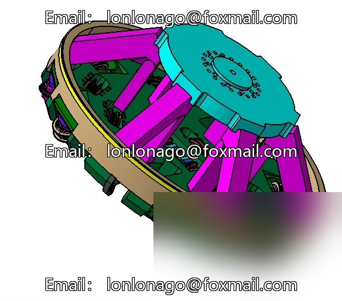
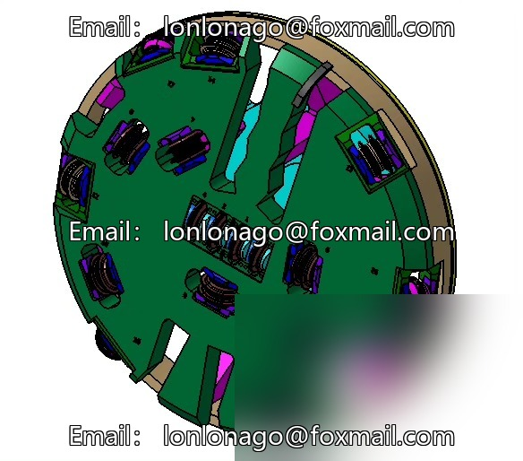
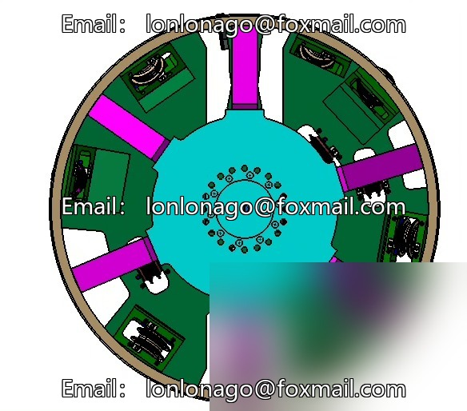

# Tapped Screw Disc Number Pattern; Tapped Screw Disc 3D; Tapped Screw Disc Data

## Body

Contraction machine disc number and model 3D 3D model of the contraction machine disc data
Can be opened and edited with catia UG SolidWorks etc.
A026 There are other various types of 3D drawings as well, for details, further discussion

The provision includes shield machine cutter disc models and 3D data, supported by catia UG SolidWorks or similar for opening and editing.

<!-- AI_ENRICHED -->

## Images

## Payment

Here is a pay link on Stripe ( https://buy.stripe.com/3cs8yP7sY87d0vu9AB ). Please contact me lonlonago@foxmail.com after funding $89, and I will send you a complete data files , thank you!

